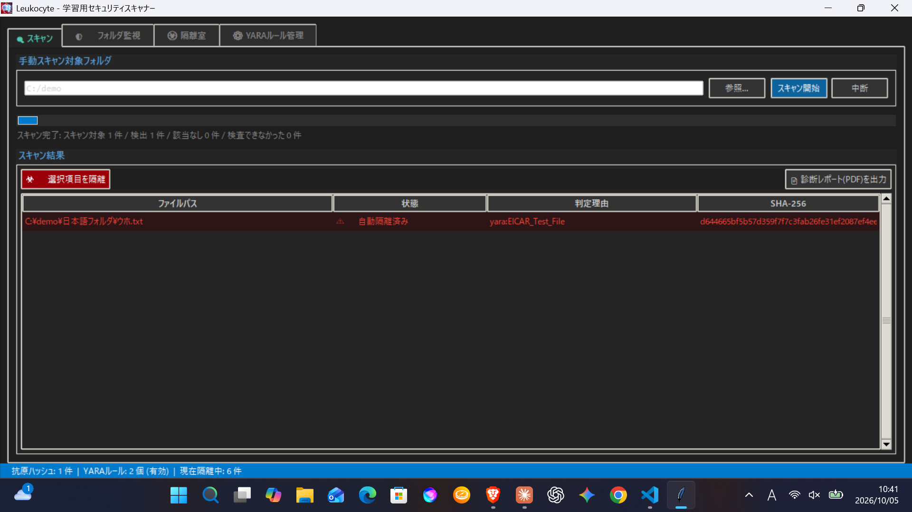

# 白血球 (Leukocyte)

Python で作成した、セキュリティの仕組みを学ぶための軽量スキャナーです。ファイルのハッシュ照合と YARA ルールを用いて、疑わしいファイルを検知し、隔離・復元までを扱います。

もともとは、就労移行支援で学ぶ人たちにプレゼントできたら、という思いで作った作品です。受け取った人が、プログラムやセキュリティの仕組みに興味を持つきっかけになれば嬉しいです。

実運用向けの本格的なセキュリティソフトではなく、仕組みを学ぶための教材・ポートフォリオとして設計しています。

## 画面



## 主な機能

- SHA-256 によるファイル照合
- YARA によるルールベース検知
- 高エントロピーによる補助的な「要確認」表示(断定はしません)
- フォルダ監視による自動スキャン
- 検知ファイルの隔離と復元
- 診断レポート(PDF)の出力
- CLI / GUI から同じコア処理を利用
- 検知ログの記録

## 作った理由

## 作った理由

セキュリティの仕組みを勉強していたとき、白血球の働きを思い出しました。異物が体に入ると、白血球が見つけて対処する。この仕組みをプログラムで再現できたら、セキュリティの考え方を理解しやすくなるのではないかと考えました。

そこで、ハッシュ照合・YARAルール・高エントロピー判定という複数の方法で調べる検知と、隔離・復元という対応までを、1つのアプリにまとめました。

| 生体の免疫 | このアプリ |
|---|---|
| 異物の目印（抗原） | 既知の不正ファイルのハッシュ（抗原ハッシュ） |
| 特徴で見分ける | YARAルールによるパターン検知 |
| 見慣れない状態に気づく | 高エントロピー（暗号化・難読化）の「要確認」表示 |
| 隔離・処理 | 隔離室への移動と、元に戻す復元 |

## 機能の詳細

### 1. ファイルのスキャン
- ルートフォルダを再帰的に走査
- SHA-256 で既知の危険ハッシュを照合
- YARA ルールとの一致確認
- 高エントロピーの判定による補助的な異常検知(圧縮・暗号化・モデルファイルなど、正常なファイルでも高くなるため「要確認」として扱います)

### 2. 常駐監視
- `watchdog` を利用して新しいファイル生成や更新を監視
- 追記や書き込み完了を待ってから検知処理を実行
- 検知イベントをCLI/GUIの両方で扱えるように設計

### 3. 隔離と復元
- 疑わしいファイルを隔離フォルダへ移動
- 元ファイルの元パスを記録
- `restore` により元の場所へ戻せる(復元先に同名ファイルがある場合は上書きしません)
- 隔離中のレコードは JSON で管理

### 4. GUI と CLI の両対応
- GUI から設定や検知結果を扱える
- CLI でも同じコアロジックを利用し、テストしやすい構成

## 使用技術

- Python 3.11+
- `watchdog`
- `hashlib` / `pathlib`
- `tkinter` (GUI)
- `YARA` (optional)
- `unittest`

<!-- TODO: 実際に動作確認した環境を書く。例: 動作確認: Windows 11 / Python 3.13 -->

## はじめかた

Python 3.11 以上が必要です。

```bash
pip install -e .
pip install -e ".[yara]"    # optional
```

### GUI を起動

```bash
python -m leukocyte
```

### フォルダをスキャン

```bash
python -m leukocyte scan <folder> --quarantine
```

### フォルダを監視

```bash
python -m leukocyte watch <folder>
```

### 隔離中のファイルを一覧表示

```bash
python -m leukocyte list
```

### ファイルを復元

```bash
python -m leukocyte restore <ID>
```

### 状態を確認

```bash
python -m leukocyte status
```

## ディレクトリ構成

```text
leukocyte/
  cli.py          CLI entry point
  gui.py          GUI entry point
  controller.py   UI-side orchestration
  core.py         Main application logic
  scanner.py      Hash and entropy scanning
  yara_engine.py  YARA integration
  watcher.py      File monitoring
  quarantine.py   Isolation + restore logic
  config.py       Configuration management
  logger.py       Logging

tests/
  test_quarantine.py

config.toml
signatures/
rules/
```

実行時に `quarantine/`(隔離ファイル)と `scan.log`(ログ)が作られます。これらは Git の管理対象外です。

## 設定

`config.toml` に以下の設定をまとめています。

- ルールディレクトリ
- ハッシュDBのパス
- 隔離フォルダ
- ログファイル
- 自動隔離の有効化
- YARA の使用有無

相対パスは `config.toml` が置かれているフォルダを基準としています。

## テスト

```bash
python -m unittest discover -s tests -v
```

> 使うときは、必ず無害なサンプルファイルを利用してください。実際のマルウェアを扱ってはいけません。動作確認には、アンチウイルス検査用の無害なテスト文字列(EICAR)を使えます。

## 制限事項

- ハッシュ照合は完全一致のみで、1 バイト違いを見逃すことがあります
- 検知は登録されたハッシュ一覧とルールに依存します
- 高エントロピーの判定は目安であり、正常なファイルも「要確認」になることがあります
- これは教育・学習用途の実装であり、本番環境でのAV/EDRとしての利用は想定していません
- 監視の対象範囲や隔離処理は、学習用途を前提に簡略化しています
- 監視中のフォルダへ隔離ファイルを復元すると、再び検知されます
- このリポジトリ自身(`rules/` やテスト)にテスト用文字列が含まれるため、リポジトリのフォルダを「隔離あり」でスキャンしないでください

## 開発中に直した問題

作る過程で見つけて直したものです。

- **隔離の索引が壊れる競合**: スキャン・監視・画面操作が別スレッドから同時に索引(JSON)を書き換えると、更新が消えたり索引が壊れたりしました。ロックなしで 40 件を並列に隔離して再現し、排他制御を入れて解消しました。再発防止のテストも追加しています。
- **報告のみモードでの二重通知**: テストを繰り返し実行して初めて見つかった不具合です。報告済みファイルのサイズと更新時刻を記録し、変わっていなければ再通知しないようにしました。
- **日本語を含むパスで、ファイルを検査できていなかった**: 日本語名のフォルダをスキャンしたとき、画面の「スキップ 17 件」が、実は「検査できなかったファイル」の数だと気づきました(18 件中 17 件)。YARA にファイルのパスを渡して開かせる方式が、日本語を含むパスと相性が悪かったと考えられ、ファイルの中身を読んで渡す方式に変えて解消しました。あわせて、「検査済み」と誤解されやすい「スキップ」の表示をやめ、「該当なし」と「検査できなかった」に分けて、理由も表示するようにしました。日本語名のフォルダに無害なテスト文字列(EICAR の一部)を置き、検知できることを確認しています。

## 作って学んだこと

この作品を通じて、以下の設計思想を実践しました。

- セキュリティ製品のコア機能を小さく再現する難しさ
- 誤検知と安全性のバランスの重要性
- 監視・検知・隔離を分離して設計する価値
- ルールベースとシグネチャベースの限界
- ユーザー体験と安全性を両立させる設計の難しさ

## 安全上の注意

このプロジェクトは学習用です。本番環境の AV/EDR や他のセキュリティ製品の代わりにはなりません。試すときは無害なサンプルファイルだけを使用し、実際のマルウェアは使わないでください。

## ライセンス

MIT License(`LICENSE` を参照)
